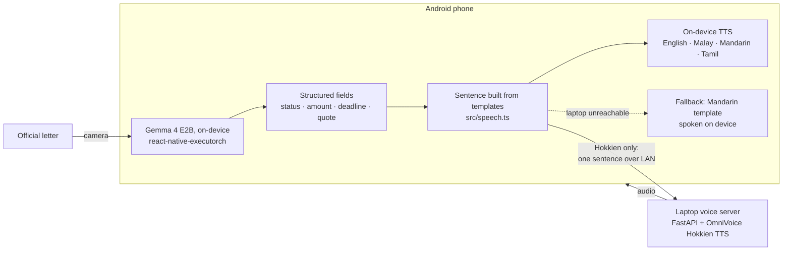
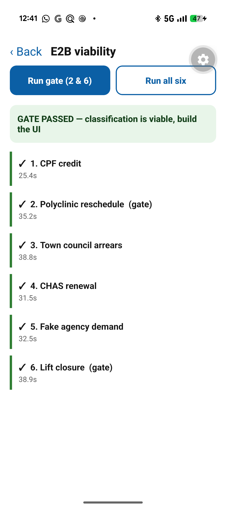

# Sun Ah (孙仔)

**Point a phone at an official letter and hear, in your own language, what it is, whether you need to act, and by when.** On-device Gemma reads the letter; the answer is spoken in Hokkien, Malay, Mandarin, Tamil or English.

Built in a weekend at a hackathon in August 2026.

## The problem

Many of Singapore's older residents cannot read the English letters that government agencies, polyclinics and town councils send them, so a payment deadline, a rescheduled appointment or a scam demand sits unread until a grandchild visits.

## Demo

https://github.com/user-attachments/assets/964535cc-5a40-437c-89c4-41b2cf8e2889

## How it works



The letter itself never leaves the phone. The model returns structured fields rather than prose, and the spoken sentence is assembled from reviewed templates, so the model cannot invent wording. Four of the five languages are voiced by offline system voices on the phone. Hokkien has no phone voice anywhere, so for Hokkien alone one summary sentence goes to a laptop on the same network; if the laptop is unreachable, the phone speaks the Mandarin template and says on the card that it has done so. An optional cloud voice (Gemini TTS, proxied through the laptop) exists but is off by default.

## Result

**6 of 6 test letters correct**, run fully on-device with Gemma 4 E2B on a Pixel 9 at 25 to 39 seconds per letter. A letter passes only if the status, amount and deadline match exactly and the model quotes the line it relied on; the six include a fake-agency scam and a reschedule letter that carries both a cancelled and a new date.

<p align="center"></p>

These runs feed the letters in as text, which isolates classification from the camera; see [Known limitations](#known-limitations).

## Known limitations

**The Hokkien has not been reviewed by a native speaker.** The templates in `src/speech.ts` are written in hanzi with Tâi-lô romanisation in the comments, so a review is one pass over one file, but that pass has not happened yet. The Malay and Tamil lines are in the same position.

**The Hokkien voice is described, not cloned.** Without a recording of a real Hokkien speaker, the voice server falls back to OmniVoice's voice-design mode. It speaks Hokkien, but the voice is synthesised from a text description. A cloning reference must itself be Hokkien, since a Mandarin or English clip carries its accent into every generated line.

**Dates from the camera path are not yet reliable.** The six-letter result above is from text input. In both recorded camera takes of the polyclinic letter, the model gave a date that appears nowhere on the letter, so the demo video deliberately makes no claim about which date was read. Fixing extraction from images is the next piece of work.

**Inference is slow.** 25 to 55 seconds per letter on a Pixel 9. The demo video cuts the waits but labels them with the real times.

**Hokkien needs the laptop.** The app is not fully offline: four of five languages are, and Hokkien sends one sentence to a machine on the local network.

---

## Engineering notes

These are the working notes from the build. It followed a written plan, the "v4 blueprint", which is not in this
repo; the § references below point at it.

---

### Corrections to the blueprint

Three things in the v4 document don't match what's actually shipping. They were
verified against the published package, not assumed.

| Blueprint says | Reality | Where it bites |
| --- | --- | --- |
| Pin `react-native-executorch` **0.8.0** | Latest stable is **0.9.3**; resource fetchers are **0.9.1** | 0.8.0 predates the model constants we rely on |
| Android loads the **XNNPACK** `.pte` | Android resolves to **Vulkan** (`gemma_4_e2b_vulkan_8da4w.pte`) | If load fails on the Pixel, it's a Vulkan problem, not an XNNPACK one |
| §1: clear the Gradle cache | **Keep it.** Deleting the emulator images frees more (6.9 GB) and a warm cache is an asset on hackathon day | An hour of re-downloading you don't have |

`models.llm.gemma4_e2b_multimodal()` is real and carries
`capabilities: ['vision', 'audio']`, exactly as §7a claims.

---

### Setup

#### Phone side

```bash
npm install
npm run selftest      # no phone needed — proves parser + templates
npm run typecheck
npx expo run:android  # dev build onto the Pixel
```

**JDK 17 is required.** `JAVA_HOME` on this machine now points at
`C:\Program Files\Java\jdk-17`. If Gradle fails with a class-file version
error, that variable has drifted back to 22.

The Gemma `.pte` downloads to the phone on first launch, not to the laptop.
Budget a few GB of free space there.

#### Laptop side

**Python 3.11, not the system 3.13.** This machine's default is 3.13, and
PyTorch publishes **no Windows cu121 wheel for cp313** — only Linux. The one
Windows/cp313 build is cu126, and that does not work here: with
`torch 2.13.0+cu126` the card enumerated correctly and raw `cuInit(0)`
returned success, but creating a compute context failed every time with
`cudaErrorDevicesUnavailable` — including with the GPU completely idle at
0 MiB. Match the driver rather than trusting CUDA minor-version
compatibility:

```bash
conda create -n sunah python=3.11 -y
conda activate sunah
cd server
pip install --no-cache-dir --index-url https://download.pytorch.org/whl/cu121 torch==2.4.1 torchaudio==2.4.1
pip install -r requirements.txt
.\run.ps1
```

`--no-cache-dir` matters: without it a 2.4 GB wheel needs 4.8 GB transiently,
and this laptop does not have the headroom.

`run.ps1` scopes `HF_HOME` to `C:\hf` for that process only, so the other repos
on this machine keep their HuggingFace caches, and prints the LAN IP to type
into the phone's settings.

**Close Brave/Chrome before starting.** The 3050 has 4 GB, the model wants 2.7,
and a Chromium browser holds ~1 GB of it. With Brave running, creating a CUDA
context failed outright (`cudaErrorDevicesUnavailable`) — not an OOM, a refusal.

**If the phone is on USB rather than Wi-Fi**, leave `scripts/keep-usb-alive.sh`
running in its own Git Bash window. `adb reverse` drops silently whenever the
USB link glitches, and the only symptom is Hokkien falling back to Mandarin,
which looks like an app bug and is not one.

Check `/health` from the phone's browser before pitching. It reports
`voice_mode`: `clone` if `ah_ma_voice.pt` exists, `design` if not.

#### If you have no Hokkien recording yet

The server no longer refuses to start. Without `ah_ma_voice.pt` it uses
OmniVoice's voice-design mode — a voice described in words rather than cloned.
It still speaks Hokkien. Record a real speaker when you can, because a cloned
ah-ma is the thing judges will remember, but a described voice beats silence.

---

### Running the viability test

§10 puts this first, before any UI: feed fixtures 2 and 6 to E2B at 09:00, not
at 16:00.

Open the app, tap the **⚑** icon, and hit **Run gate (2 & 6)**. It runs the
letters as *text*, which works before the camera is wired and isolates
classification from OCR. Scoring is automatic — pass/fail is a number, not a
judgement made while tired.

If the gate fails, §4 says switch to `useOCR` + text-only or to templated
output, then commit and stop switching.

If the gate passes but the camera path fails, the problem is vision
specifically, and mitigation 4 is the fix.

---

### Layout

```
src/types.ts       Status, Lang, LetterResult
src/prompt.ts      The §5 prompt, plus few-shot from fixtures 1, 2, 5
src/fixtures.ts    The six test letters with expected results and traps
src/parse.ts       Three layers of JSON recovery (§7g) + automatic scoring
src/speech.ts      Hokkien/EN/MS/CMN/TA templates — mitigation 5
src/audio.ts       The §9 fallback chain
src/config.ts      Language, address form, laptop IP, cloud toggle
src/theme.ts       Card colours — blue for CONDITIONAL (§9)
src/selftest.ts    Node-side smoke test, no phone required

components/ResultCard.tsx     Paints before any audio call (§7c)
components/SetupScreen.tsx    Five language buttons, shown once
components/FixtureRunner.tsx  The 09:00 viability test

server/main.py                FastAPI + OmniVoice, fp16, GPU lock
server/make_voice_prompt.py   Build ah_ma_voice.pt once, before Saturday

scripts/keep-usb-alive.sh     Re-establishes adb reverse every 10 s (Git Bash)
docs/demo-video/              HyperFrames source for the demo video, see SCRIPT.md
docs/gate-results.png         Screenshot of the six-fixture run on the Pixel
```

---

### The privacy claim needs one line of code to be true

Section 3 says to put this on a slide: *"For four of five languages the voice
is offline too."*

As originally written, that was **false on this Pixel**. Passing only a
`language` to `expo-speech` lets Google TTS pick its own default, and it picked
`cmn-cn-x-ssa-server` — synthesis on Google's servers — while seven offline
`zh` voices sat installed and unused. `src/audio.ts` now resolves an offline
voice per language at startup and names it explicitly; dispatch moved to
`cmn-cn-x-cce-seanet-embedded`.

**Verify this on whatever phone you demo on**, because the voice inventory is
per-device. Open the app, tap **⚑**, hit **Test voice + laptop**:

```
language: 福建话
device voices for zh: 16 (7 offline)
laptop http://192.168.43.12:8000: unreachable
played from: device-fallback
```

If it says `(0 offline)` for your language, the claim does not hold — install
the language pack under Android's text-to-speech settings first.

### When Hokkien has no voice

There is no Hokkien voice on any phone, so with the laptop unreachable the app
falls back to the Mandarin **template** — not the Hokkien string read by a
Mandarin voice, which would pronounce 毋通 as "wu tong" and mean nothing. The
card says `福建话无声，用华语讲` when it does this, because a Hokkien speaker
hearing unexplained Mandarin concludes the app is broken.

Mandarin rather than English is deliberate: a Singaporean who chose Hokkien is
far likelier to follow 华语.

---

### Design decisions worth knowing

**The model never writes the spoken sentence.** It returns structured fields;
`speech.ts` assembles the sentence from templates. That's §4 mitigation 5, and
it removes the failure mode where the model writes Mandarin-style Chinese that
the TTS pronounces as Hokkien-accented Mandarin.

**Numbers are spelled out in hanzi** for Hokkien and Mandarin — `一百三十二箍`,
not `132`. §13 flags number-heavy content as outside the TTS model's tested
range.

**Unknown English senders are dropped, not read aloud.** A Hokkien voice asked
to say "Ang Mo Kio Polyclinic" will mangle it, so `speech.ts` maps the agencies
we know to hanzi and omits the clause when it doesn't recognise one.

**An unclassifiable letter defaults to `CONDITIONAL`, not `INFO_ONLY`.**
Conditional means *read this*; defaulting to green would mean *ignore this*.

**A malformed date becomes `null`.** "27 August" and "next Thursday" are
rejected rather than guessed. A wrong date is the most dangerous output the
system can produce — fixture 2 exists for exactly this.
